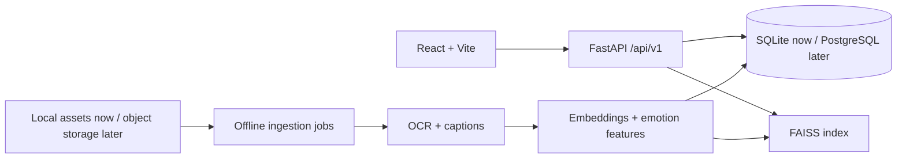
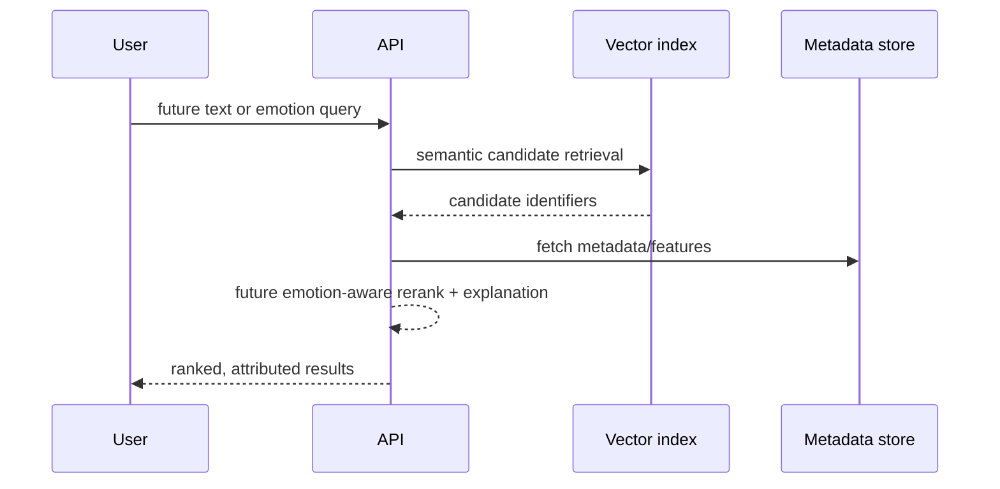

# Architecture

The browser and API are independently deployable. The API owns request validation, metadata orchestration, and recommendation contracts; it does not load models in Phase 1. Offline processing will own expensive OCR, captions, embeddings, quality checks, and index construction. This prevents query latency from being tied to ingestion and enables restartable batch jobs.

Metadata, binary assets, vectors, model artifacts, and processing state have distinct storage boundaries. SQLite is adequate for the academic MVP; migrate metadata to PostgreSQL when concurrent writers, richer querying, or service deployment demand it. FAISS remains a replaceable vector-store boundary. For 100K+ memes, use versioned shards/index snapshots, incremental ingestion, idempotency keys, content hashes, checkpoints, and failure records. No background worker is implemented in Phase 1.
